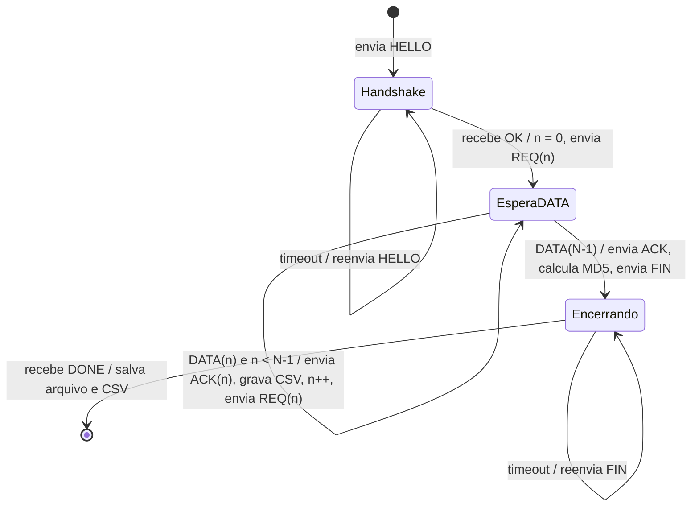

# RDT-UnB — Stop-and-Wait, Go-Back-N e Selective Repeat

Cliente de transferência confiável de arquivos sobre UDP (CIC0236 — TR2, 2026/2).
Entrega 1: Stop-and-Wait (SAW). Entrega 2: janela deslizante com Go-Back-N (GBN) e
Selective Repeat (SR), simulação de perda e comparação dos três protocolos.

Grupo 10: Anna Luiza Novaes Jansen Silva (232024572) e Vinicius Henrique Barbosa Silverio de Castro (232006832).

## Arquivos

| Arquivo | Função |
|---|---|
| `cliente.py` | Ponto de entrada: lê os argumentos, faz o handshake, chama o protocolo escolhido e encerra |
| `comum.py` | Tudo o que não depende do protocolo: pacotes, `HELLO/OK`, `FIN/DONE`, MD5, simulação de perda, CSV e resumo |
| `saw.py` | Stop-and-Wait (janela 1) |
| `gbn.py` | Go-Back-N |
| `sr.py` | Selective Repeat |
| `graficos.py` | Gráfico de throughput, RTT e eventos (timeout / perda simulada) de **uma** execução |
| `comparacao.py` | Tabela e gráficos comparativos SAW × GBN × SR a partir do resumo |
| `resultados/` | Resultados oficiais da Entrega 2 (21 cenários), tabela e gráficos comparativos |
| `entregas/entrega1/dados/` | CSVs, gráficos, `resumo.csv` e log das execuções da Entrega 1 |
| `demo/` | Saída das execuções de teste e da demo ao vivo (ignorada pelo git) |

### Entregas (tags git) e zip para o Aprender3

Cada entrega é marcada com uma tag (`entrega1`, `entrega2`, `entrega3`, `final`). O zip é gerado a partir da tag:
```bash
git archive --format=zip --prefix=grupo10_entrega2/ -o grupo10_entrega2.zip entrega2
```

## O que precisa instalar

- **Python 3**: o cliente (`cliente.py`, `comum.py`, `saw.py`, `gbn.py`, `sr.py`) só usa a biblioteca
  padrão e roda com qualquer `python3`.
- **matplotlib**: só para os gráficos. O Python do Homebrew não deixa instalar pacotes no
  sistema (PEP 668), então ele fica num ambiente virtual `.venv` dentro do projeto:
  ```bash
  python3 -m venv .venv
  .venv/bin/python -m pip install matplotlib
  ```
  `graficos.py` e `comparacao.py` devem ser rodados com `.venv/bin/python`.
- **Wireshark**: só é cobrado no Relatório Final (seção "Análise com Wireshark").

## Como rodar

```bash
python3 cliente.py --group grupo10 --file small --protocol saw
python3 cliente.py --group grupo10 --file small --protocol gbn --window 8
python3 cliente.py --group grupo10 --file small --protocol sr  --window 16 --loss 0.10 --seed 42
```

| Opção | Padrão | O que faz |
|---|---|---|
| `--group` | **obrigatório** | ID do grupo, enviado no `HELLO`. Sem ele o cliente não roda |
| `--protocol` | `saw` | `saw`, `gbn` ou `sr` |
| `--window` | — | Tamanho da janela (obrigatório em `gbn`/`sr`; o SAW usa sempre 1) |
| `--loss` | `0` | Probabilidade de descartar cada `DATA` recebido (`0.05` = 5 %). **Na demo: sem `--loss`** |
| `--seed` | aleatória | Seed do sorteio de perda, para repetir exatamente a mesma sequência |
| `--file` | `small` | `small` (1 MB), `medium` (5 MB) ou `large` (10 MB) |
| `--outdir` | `resultados` | Pasta de saída. Para testes e para a demo use `--outdir demo` |
| `--server`, `--port` | `137.131.178.229`, `8080` | Endereço do servidor |
| `--segment-size`, `--timeout`, `--max-retries` | `512`, `500` ms, `50` | Tamanho do segmento, timeout fixo e limite de retransmissões |

Cada execução grava em `<outdir>/<arquivo>_<protocolo>_w<janela>_loss<perda>/`:
- `recebido_<grupo>_<arquivo>.bin` — o arquivo baixado (fora do git);
- `metrics_<grupo>_<protocolo>_<AAAAMMDD_HHMMSS>.csv` — métricas por segmento;

e acrescenta uma linha em `<outdir>/resumo_entrega2.csv` (tempo, RTT médio, throughput teórico e
medido, retransmissões, timeouts, descartes simulados, seed, MD5 e DONE).

### Gráficos e comparação

```bash
.venv/bin/python graficos.py resultados/small_gbn_w16_loss10/metrics_grupo10_gbn_<data>.csv
.venv/bin/python comparacao.py
```

- `graficos.py` gera um `.png` ao lado do CSV: throughput (média móvel), RTT e a faixa de eventos
  (timeouts e perdas simuladas em linhas separadas).
- `comparacao.py` lê o `resumo_entrega2.csv` e gera em `resultados/`: `tabela_comparativa.csv` e
  `.tex` (para o Overleaf), `comparacao_perda.png`, `comparacao_janela.png` e
  `comparacao_segmentos_w16_loss5/10.png`. Se um cenário foi rodado mais de uma vez, usa a
  execução **mais recente**; execuções com MD5 errado ou de outro grupo são ignoradas.

### Rodar os 21 cenários da comparação (~20 min)

Testa o servidor com `PING` antes; só apaga e roda se ele responder.
```bash
python3 -c "import socket; s=socket.socket(socket.AF_INET,socket.SOCK_DGRAM); s.settimeout(3); s.sendto(b'PING',('137.131.178.229',8080)); s.recvfrom(2048)" && rm -rf resultados && for c in "saw 1" "gbn 4" "gbn 8" "gbn 16" "sr 4" "sr 8" "sr 16"; do p=${c% *}; w=${c#* }; for l in 0 0.05 0.10; do echo "=== $p janela $w perda $l ==="; python3 cliente.py --group grupo10 --file small --protocol $p --window $w --loss $l --seed 42 | tail -9; done; done && for f in resultados/*/metrics_grupo10_*.csv; do .venv/bin/python graficos.py "$f"; done && .venv/bin/python comparacao.py
```

### Roteiro da demo da Entrega 2

Sempre com `--outdir demo`, para não alterar a tabela de `resultados/`.
```bash
python3 cliente.py --group grupo10 --file small --protocol gbn --window 16 --outdir demo
python3 cliente.py --group grupo10 --file small --protocol sr  --window 16 --outdir demo
```
Segmentos com retransmissão no último CSV da demo (perda natural aparece com `perda simulada 0`):
```bash
python3 -c "import csv,glob,os; f=max(glob.glob('demo/**/metrics_*.csv', recursive=True), key=os.path.getmtime); print(f); [print('seg', r['segment'], '| retx', r['retransmissions'], '| timeout', r['timeout_occurred'], '| perda simulada', r['simulated_loss'], '| timeout_ms', r['timeout_ms']) for r in csv.DictReader(open(f)) if int(r['retransmissions'])>0]"
```
Tabela comparativa com o SAW: `.venv/bin/python comparacao.py`. Só se o professor pedir perda ao
vivo: as mesmas linhas com `--window 8 --loss 0.05 --seed 42` (< 1 min cada).

---

# Entrega 2 — Janela deslizante: GBN e SR

## Checklist da 2ª entrega parcial

| Exigência | Onde está |
|---|---|
| GBN: janela de N REQs sem ACK; timeout retransmite o segmento e todos os seguintes | `gbn.py` |
| SR: janela de N REQs; retransmite só o segmento com timeout | `sr.py` |
| SR: armazena fora de ordem e reordena | `sr.py` (`payloads[seq]`, `received[]`) |
| Janelas 4, 8 e 16 | `resultados/small_{gbn,sr}_w{4,8,16}_*` |
| Simulação de perda, método descrito e justificado | `comum.recv_data` + seção "Simulação de perda" |
| CSV registra, por segmento, se a perda foi simulada | colunas `simulated_loss` e `sim_drops` |
| SAW, GBN e SR sem perda, com 5 % e com 10 % | 21 cenários em `resultados/` (26/10/2026) |
| Tabela com throughput médio, retransmissões e tempo total | `resultados/tabela_comparativa.csv` / `.tex` |
| Explicar com dados por que o GBN sofre mais que o SR | seção "Por que o GBN sofre mais que o SR" |
| Demo sem simulação de perda | roteiro acima (`--outdir demo`, sem `--loss`) |

## Arquitetura do código

O `cliente.py` só lê os argumentos, cria a sessão, faz o handshake, carrega o protocolo pelo nome
(`importlib.import_module(args.protocol)`) e chama `finish`. Os três protocolos seguem a mesma
interface:

```python
payloads, rows = protocolo.run(sess)   # payloads em ordem; rows = linhas do CSV
```

O estado compartilhado fica no dicionário `sess` (`comum.new_session`), e cada protocolo usa as
mesmas primitivas do `comum.py`:

| Função | O que faz |
|---|---|
| `send_req(sess, seq)` | Envia `REQ|seq=n`, conta o envio e guarda o instante (`sess["last_send"][seq]`) |
| `recv_data(sess, deadline)` | Espera um `DATA` até o **instante** `deadline`; aplica a perda simulada; devolve `(seq, payload, t_recv)` ou `None` |
| `send_ack(sess, seq)` | Envia `ACK|seq=n` |
| `make_row(...)` | Monta a linha do CSV do segmento aceito |
| `finish(sess, payloads, rows)` | MD5, `FIN/DONE`, salva `.bin`, CSV e linha do resumo |

Cada protocolo só decide **quando** mandar REQ e **o que fazer** com cada DATA.

**Adaptação ao servidor pull-based.** No Kurose, o remetente envia dados e a janela anda com os
ACKs que ele recebe. Aqui o servidor só responde a `REQ`: quem controla a janela é o cliente, e o
que ele recebe é `DATA`. Então "chegou o DATA da base" faz o papel do "chegou o ACK da base" do
livro, e os ACKs que o cliente envia só confirmam o segmento ao servidor.

## Simulação de perda

**Método:** abordagem (a) do enunciado — o `DATA` chega de verdade, mas, dentro de
`comum.recv_data`, é descartado com probabilidade P (`--loss`) **antes de qualquer
processamento**, como se a rede o tivesse perdido. O efeito no protocolo é o de uma perda real:
o temporizador estoura e o REQ é reenviado.

**Por que não a abordagem (b)** (receber o DATA e não mandar o ACK): o servidor é pull-based e o
cliente só avança quando recebe o DATA. Deixar de mandar o ACK não provoca nenhum timeout nem
retransmissão, então a (b) não simularia perda nenhuma neste protocolo.

**Um único ponto para os três protocolos:** como todos recebem DATA pelo mesmo `recv_data`, a
perda é aplicada exatamente igual no SAW, no GBN e no SR.

**Repetibilidade:** o sorteio usa `random.Random(seed)`. Todos os cenários oficiais usam
`--seed 42`, e a seed fica registrada no resumo. Sem `--loss` (padrão), nenhum sorteio é feito.

**Separando perda simulada de perda natural (colunas extras do CSV):**

| Coluna | Significado |
|---|---|
| `simulated_loss` | 1 se algum DATA deste segmento foi descartado pela simulação |
| `sim_drops` | quantos DATA deste segmento a simulação descartou |
| `recv_time_ms` | instante da aceitação, desde o início da transferência |

Uma retransmissão com `simulated_loss = 0` é perda **natural** da rede. No GBN-16, uma única
perda natural gera 16 retransmissões (a base e os 15 seguintes).

Observação: a perda é sorteada **por DATA recebido**, não por segmento. No GBN cada segmento chega
várias vezes (por causa do "volta N"), então ele consome mais sorteios e tem mais descartes que o
SAW e o SR com a mesma seed (541 × 220 com 10 %). A probabilidade por pacote é a mesma para todos.

## Go-Back-N (`gbn.py`)

```
base = 0; next_seq = 0
enquanto base < total:
    enquanto next_seq < base + N:          # enche a janela
        envia REQ(next_seq); se next_seq == base: liga o timer
        next_seq += 1
    espera DATA até timer_base + timeout
    se timeout:                            # "volta N"
        reenvia REQ(base .. next_seq-1); reinicia o timer
    se DATA(seq) e seq == base:            # só aceita em ordem
        ACK(seq); guarda; base += 1; reinicia o timer
    senão: descarta (fora de ordem ou duplicata)
```

- **Um único temporizador**, o da base: se a base não chega, nada depois dela é aproveitado.
- **Sem buffer:** DATA fora de ordem é descartado e será pedido de novo no "volta N".
- No CSV, `timeout_occurred = 1` só no segmento que estava na base quando o timer estourou; os que
  foram reenviados "de carona" aparecem só em `retransmissions`.

## Selective Repeat (`sr.py`)

```
base = 0; next_seq = 0; buffer[total] = vazio
enquanto base < total:
    enquanto next_seq < base + N: envia REQ(next_seq); next_seq += 1
    pendentes = segmentos da janela ainda não recebidos
    espera DATA até min(last_send[pendentes]) + timeout
    se timeout: reenvia REQ só dos pendentes cujo timer estourou
    se DATA(seq) na janela e ainda não recebido:
        ACK(seq); buffer[seq] = payload       # aceita fora de ordem
        enquanto buffer[base] cheio: base += 1  # desliza
```

- **Um temporizador por segmento** (`sess["last_send"][seq] + timeout`). Com um único socket, o
  `recv_data` espera até o **menor** prazo pendente.
- **Buffer de fora de ordem:** `payloads = [None] * total`; o arquivo é montado na ordem do `seq`.
- DATA duplicado ou fora da janela é descartado sem novo ACK: aqui quem pede é o cliente, então
  não há remetente esperando esse ACK para reenviar.

## Resultados — grupo10 (26/10/2026, 17:39–18:11, `small`, 512 B, timeout fixo 500 ms, `--seed 42`)

Todos os 21 cenários terminaram com MD5 `f989450f6ca695013ceb6bd3a5f6417c` e `DONE ok=1`.

| Protocolo | Janela | Sem perda: kbps / retx / s | 5 %: kbps / retx / s | 10 %: kbps / retx / s |
|---|---|---|---|---|
| SAW | 1 | 167,2 / 0 / 50,2 | 88,3 / 91 / 95,0 | 52,0 / 220 / 161,3 |
| GBN | 4 | 657,7 / 0 / 12,8 | 140,7 / 360 / 59,6 | 63,8 / 921 / 131,5 |
| GBN | 8 | 1235,5 / 0 / 6,8 | 152,0 / 744 / 55,2 | 66,9 / 1848 / 125,4 |
| GBN | 16 | 2025,5 / 0 / 4,1 | 159,5 / 1512 / 52,6 | 70,3 / 3562 / 119,3 |
| SR | 4 | 635,2 / 0 / 13,2 | 161,6 / 91 / 51,9 | 84,4 / 220 / 99,5 |
| SR | 8 | 1162,5 / 0 / 7,2 | 192,7 / 91 / 43,5 | 109,6 / 220 / 76,5 |
| SR | 16 | 1900,7 / 0 / 4,4 | 260,7 / 91 / 32,2 | 153,7 / 220 / 54,6 |

CSVs, gráficos por execução, tabela e gráficos comparativos: `resultados/`.

### Impacto do tamanho da janela

- **Sem perda, a janela multiplica a vazão** (`throughput ≈ N × L / RTT`): SAW 167 → N=4 ~650 →
  N=8 ~1200 → N=16 ~2000 kbps, com eficiência de 99 % em todos. O ganho com N=16 é ~12×, não 16×,
  porque o RTT médio sobe de ~24 ms para ~32–34 ms com 16 REQs em voo (enfileiramento).
- **Sem perda, GBN e SR se comportam igual** (ex.: N=8: 1236 × 1163 kbps); a diferença só aparece
  quando há perda.
- **Com perda, a janela quase não ajuda o GBN** (10 %: 64 → 67 → 70 kbps), **mas ajuda o SR**
  (10 %: 84 → 110 → 154 kbps).

### Por que o GBN sofre mais que o SR com perda alta

1. **Retransmissões ≈ N por timeout no GBN, 1 por perda no SR.** Com 10 % de perda:

   | | Timeouts | Retransmissões | Retx ÷ timeout |
   |---|---|---|---|
   | GBN-4 | 218 | 921 | 4,2 |
   | GBN-8 | 206 | 1848 | 9,0 |
   | GBN-16 | 207 | 3562 | 17,2 |
   | SR-4 / 8 / 16 | 207 / 195 / 191 | 220 / 220 / 220 | ~1,1 |

   O SR retransmite exatamente uma vez por DATA perdido (220 retransmissões = 220 descartes
   simulados, em qualquer janela). O GBN reenvia a janela inteira a cada timeout: com N=16 foram
   **16× mais retransmissões** que o SR, para as mesmas perdas.
2. **Os timeouts do GBN se somam; os do SR se sobrepõem.** O número de timeouts (~200) é parecido
   nos dois, mas no GBN cada timeout trava tudo (~200 × 0,5 s ≈ 100 s dos 119 s do GBN-16). No SR,
   enquanto um segmento espera o timeout, os outros da janela continuam chegando e vão para o
   buffer: o SR-16 teve 191 timeouts (que somados dariam 95 s) e terminou em **54,6 s**.
3. **Por isso a janela só ajuda o SR:** quanto maior N, mais trabalho útil acontece durante a
   espera. Com 10 % de perda, o SR-16 (154 kbps) chega perto do SAW **sem** perda (167 kbps).

**Robustez à seed:** repetindo GBN-16 e SR-16 com 10 % de perda com as seeds 7 e 123, o GBN teve
3825 e 3668 retransmissões e o SR 231 e 247 (variação de até ~7 %); a diferença de ~16× entre eles
se manteve.

---

# Entrega 1 — Stop-and-Wait

## Máquina de estados do cliente (SAW)



## Explicação do código

Na Entrega 1 tudo ficava no `cliente.py`. Na Entrega 2 o código foi dividido: o loop do SAW foi
para `saw.py` e o resto (pacotes, handshake, MD5, CSV) para `comum.py`. A lógica é a mesma.

### 1. Por que UDP e o que o cliente precisa fazer

UDP só entrega datagramas "se der": pacotes podem se perder, chegar duplicados ou fora de ordem,
e não existe conexão. O TCP resolve isso com ACKs, timeouts e retransmissões. Aqui o servidor só
fala UDP, então **o cliente** implementa esses mecanismos.

O servidor é *pull-based*: ele nunca manda dados por conta própria, só responde a um `REQ`.
Por isso quem controla o ritmo, detecta perdas e retransmite é sempre o cliente.

### 2. Socket

```python
sock = socket.socket(socket.AF_INET, socket.SOCK_DGRAM)
```
`AF_INET` = IPv4, `SOCK_DGRAM` = UDP. Não há `connect()`: cada `sendto()` leva o endereço
`(IP, porta)` do servidor, e `recvfrom()` devolve um datagrama inteiro. `RECV_BUFFER = 65535` é o
maior datagrama UDP possível, então um `DATA` nunca é cortado.

### 3. Argumentos (`argparse`)

`--group` é `required=True`: se faltar, o `argparse` imprime erro e encerra antes de abrir o socket.
O valor vai no campo `grupo=` do `HELLO` e decide qual arquivo (seed) o servidor gera.

### 4. Formato dos pacotes

Tudo é texto separado por `|`, menos o payload do `DATA`, que é **binário**.

- `parse_fields` transforma `["seq=3", "total=512"]` em `{"seq": "3", "total": "512"}`.
- `parse_text_packet` trata `OK`, `DONE` e `PONG` (texto puro).
- `parse_data_packet` trata `DATA|seq=<n>|total=<b>|<payload>`. O ponto importante é
  `data.split(b"|", 3)`: divide **no máximo 3 vezes**. Como o payload é binário, ele pode conter
  o byte `|` (0x7C). Se dividíssemos em todos os `|`, o payload seria cortado e o MD5 falharia.
  Também não fazemos `decode()` do payload, porque bytes arbitrários não são texto válido.

### 5. Handshake `HELLO` / `OK` — função `request_reply`

```
HELLO|grupo=grupo10|segment_size=512|file=small
OK|file_size=...|checksum=<md5>|seed=...|total_segments=...|segment_size=...
```
O `HELLO` também pode se perder, então `request_reply` envia, espera até o timeout e, se nada
chegar, **retransmite** (até `--max-retries` vezes). Do `OK` guardamos `file_size`,
`checksum` (MD5 esperado), `total_segments` e o `segment_size` que o servidor confirmou
(é a "negociação": usamos o valor que ele devolveu, não o que pedimos).

A mesma função é reaproveitada no fim para `FIN` → `DONE`. `HELLO/OK` e `FIN/DONE` não passam
pela perda simulada.

### 6. Loop Stop-and-Wait (`saw.py`)

Para cada `seq` de `0` a `total_segments - 1`:

1. Envia `REQ|seq=n` (`send_req`) e calcula o prazo `t_envio + timeout`.
2. Espera com `recv_data(sess, prazo)`, que ajusta o `settimeout` ao tempo que falta.
   - Se chegar `DATA` com o **mesmo** `seq`: aceita.
   - Se chegar `DATA` com **outro** `seq`: é uma duplicata atrasada (ex.: o servidor respondeu
     duas vezes porque retransmitimos um REQ). É descartada, e o prazo continua correndo.
3. Se o prazo acabar sem o `DATA` certo: **timeout** → reenvia o mesmo `REQ`. Do ponto de vista
   do cliente não dá para saber se perdeu o REQ ou o DATA; nos dois casos a solução é pedir de novo.
4. Recebeu: envia `ACK|seq=n`, guarda o payload e passa para `n+1`.

"Stop-and-wait" = só existe **um** segmento pendente por vez (janela = 1). GBN e SR com N = 1
se reduzem a ele.

### 7. Métricas por segmento (CSV)

| Coluna | Como é calculada |
|---|---|
| `segment` | `seq` |
| `timestamp` | hora local ISO 8601 com microssegundos, no momento de aceitar o segmento |
| `size_bytes` | `len(payload)` (o último segmento costuma ser menor) |
| `rtt_ms` | tempo entre o **último** REQ enviado deste `seq` e o DATA |
| `rtt_estimated_ms` | vazio: a EWMA é da Entrega 3 (a coluna já existe para manter o formato) |
| `timeout_ms` | timeout vigente no momento deste segmento (fixo: `--timeout`) |
| `throughput_kbps` | bits do segmento ÷ tempo desde a chegada aceita anterior (a soma dos intervalos é o tempo total) |
| `retransmissions` | quantas vezes o REQ deste segmento foi reenviado |
| `timeout_occurred` | 1 se este segmento teve timeout |
| `window_size` | 1 no SAW; N no GBN/SR |
| `protocol` | `saw`, `gbn` ou `sr` |
| `simulated_loss`, `sim_drops`, `recv_time_ms` | colunas da Entrega 2 (ver "Simulação de perda") |

Nome: `metrics_<grupo>_<protocolo>_<AAAAMMDD_HHMMSS>.csv`, como pede o enunciado.

**Detalhe do RTT com retransmissão (algoritmo de Karn):** se o REQ foi retransmitido, o DATA
que chegou pode ser resposta do REQ antigo, e aí o RTT seria ambíguo. Medimos a partir do
último envio, o que pode subestimar o RTT nesses casos. O TCP resolve isso ignorando amostras
de segmentos retransmitidos no cálculo do RTT estimado; vale lembrar disso na Entrega 3.

Usamos `time.perf_counter()` para medir intervalos: é monotônico (ajuste do relógio do sistema não
afeta) e tem resolução maior que o `time.monotonic()`. Para o `timestamp` do CSV usamos
`datetime.now()` (relógio do sistema), o mesmo que o Wireshark usa, o que facilita a correlação no
relatório final.

### 8. Integridade: MD5 e `FIN` / `DONE` (`comum.finish`)

Depois do último segmento, os payloads são juntados em ordem, cortados em `file_size` bytes e o MD5
é calculado com `hashlib.md5`. Comparamos com o `checksum` do `OK` e mandamos
`FIN|checksum=<md5>`. O servidor responde `DONE|ok=1` (arquivo íntegro) ou `ok=0`.
Se algo falhar, o programa sai com código 1. **O MD5 vai no relatório.**

### 9. Resumo impresso no fim

Tempo total, RTT médio/mín/máx, retransmissões e segmentos com timeout, DATA descartados pela
simulação, throughput medido (`file_size × 8 / tempo_total`), throughput teórico
(`janela × segment_size × 8 / RTT_médio`) e a eficiência (medido ÷ teórico).

## Análise pedida no enunciado (Entrega 1)

### a) Por que o throughput do SAW é limitado pelo RTT?

No Stop-and-Wait o cliente pede **um** segmento e fica parado esperando ele chegar. Em cada
RTT, só um segmento (512 bytes) atravessa a rede. Não importa se o link aguenta 100 Mbps: o
"cano" fica vazio quase todo o tempo, porque o tempo de transmissão de 512 bytes é microssegundos
e o RTT é dezenas de milissegundos. Por isso:

```
Throughput_SAW ≈ L / RTT          (L = tamanho do segmento em bits)
```

Utilização do canal (Kurose, seção 3.4): `U = (L/R) / (RTT + L/R)`. Com L = 4096 bits,
R = 100 Mbps e RTT = 44 ms: `L/R ≈ 0,04 ms`, então `U ≈ 0,04 / 44 ≈ 0,09 %`. Dobrar a banda
quase não muda nada; o que manda é o RTT. É exatamente isso que motiva as janelas
(GBN/SR) da Entrega 2: mandar vários REQs por RTT.

### b) Throughput teórico máximo vs medido

```
Throughput_máx = segment_size × 8 / RTT
```

Com o RTT do PING de teste (≈ 44 ms): `512 × 8 / 44 ms ≈ 93 kbps`.
(Exemplo do enunciado: 512 × 8 / 22 ms ≈ 186 kbps.)

O cliente imprime os dois valores no fim usando o RTT médio real da sessão. O medido fica
**abaixo** do teórico porque:

- **Timeouts:** cada perda custa um timeout inteiro (500 ms ≈ 11 RTTs) sem nenhum dado chegando.
- **Variação do RTT:** alguns segmentos demoram bem mais que a média.
- **Overhead do cliente:** enviar o ACK, montar strings, gravar a linha do CSV, etc. É pequeno
  (microssegundos), mas existe.
- **Cabeçalho:** o que conta como "dado útil" é só o payload; o texto `DATA|seq=...|total=...|`
  e os cabeçalhos UDP/IP também ocupam a rede, mas não entram no throughput.

## Resultados da Entrega 1 — grupo10 (13/10/2026, segment_size = 512 B, timeout fixo = 500 ms)

| Arquivo | Segmentos | Tempo total | RTT médio | Teórico | Medido | Eficiência | Retransmissões | MD5 | DONE |
|---|---|---|---|---|---|---|---|---|---|
| small (1 MB) | 2 048 | 131,9 s | 38,49 ms | 106,41 kbps | 63,62 kbps | 59,8 % | 105 | `f989450f6ca695013ceb6bd3a5f6417c` | ok=1 |
| medium (5 MB) | 10 240 | 588,7 s | 39,17 ms | 104,56 kbps | 71,25 kbps | 68,1 % | 370 | `2593bb16a3f52e31a7b8773450e8da8b` | ok=1 |
| large (10 MB) | 20 480 | 965,9 s | 35,58 ms | 115,13 kbps | 86,84 kbps | 75,4 % | 465 | `5623bc385a7b296e6c57d99290c03c0f` | ok=1 |

Dados, CSVs e gráficos: `entregas/entrega1/dados/`.

### De onde vem a diferença entre teórico e medido

O tempo total se explica quase exatamente por **N × RTT + retransmissões × timeout**:

| Arquivo | N × RTT médio | Retx × 0,5 s | Soma | Tempo real | Sobra (overhead do cliente) |
|---|---|---|---|---|---|
| small | 79 s | 52 s | 131 s | 132 s | ~1 s |
| medium | 401 s | 185 s | 586 s | 589 s | ~3 s |
| large | 729 s | 232 s | 961 s | 966 s | ~5 s |

- **Os dados confirmam (a):** fora os timeouts, cada segmento custou exatamente um RTT. Tirando
  o tempo parado em timeout, o throughput fica em ~104–114 kbps, praticamente igual ao teórico
  `512 × 8 / RTT`. O link aguentaria muito mais; o limite é o RTT.
- **A perda é o que derruba o medido (b):** a taxa de perda (retx ÷ envios) foi 4,9 %, 3,5 % e 2,2 %.
  Cada perda custa 500 ms parado, cerca de 13 RTTs. No small, 40 % do tempo foi gasto esperando
  timeout; por isso a eficiência foi a menor (59,8 %). No large, com menos perda proporcional,
  chegou a 75,4 %.
- **Overhead do código é desprezível:** 1–5 s em 2–16 min (< 1 %). Ou seja, a diferença
  não é "overhead desnecessário no código" (Dica 2 do enunciado), é perda + timeout.
- **O RTT varia bastante:** mínimo ~19 ms, mediana ~26–30 ms, picos de até 243 ms. A média
  (~36–39 ms) fica acima da mediana por causa desses picos. Isso também mostra que um timeout fixo
  de 500 ms é grande demais na maior parte do tempo — motivação para o RTT adaptativo (Entrega 3).
- **Na rede real há perda natural:** os três testes tiveram retransmissões sem nenhuma
  simulação de perda; inclusive o `HELLO` do large precisou ser reenviado 3 vezes.

## Entrega 3 — RTT adaptativo no GBN e SR

GBN e SR suportam `--timeout-mode adaptive`; SAW continua usando timeout fixo. O primeiro
RTO adaptativo é o valor de `--timeout` (500 ms por padrão). Após uma amostra válida, o
cliente inicializa `SRTT = R` e `DevRTT = R/2`; nas amostras seguintes usa α e β e calcula
`RTO = SRTT + 4 × DevRTT`. Amostras de segmentos retransmitidos são excluídas pelo algoritmo
de Karn. O RTO é guardado por envio: o SR usa o prazo próprio de cada segmento; o GBN mantém
um único timer para a base e o reinicia quando a base avança ou é retransmitida. Há limites
operacionais de 1 ms e 60 s.

O CSV por segmento inclui RTT medido, RTT estimado, DevRTT, timeout usado (o RTO vigente no
envio do REQ), modo, α e β. Cada execução grava em
`<outdir>/<arquivo>_<protocolo>_w<janela>_loss<perda>_<modo>/`, com `<modo>` = `fixo500` ou
`adapt_a<α>_b<β>`, e acrescenta uma linha em `<outdir>/resumo_entrega3.csv` (inclui timeout
médio e final, RTT estimado e DevRTT finais).

### Roteiro dos experimentos

```bash
caffeinate -i ./rodar_entrega3.sh varredura                         # α × β, SR-16, small (~20 min)
.venv/bin/python rtt_adaptativo.py varredura                        # tabela + mapas de calor -> escolher α, β
caffeinate -i env ALPHA=0.25 BETA=0.125 ./rodar_entrega3.sh comparacao   # fixo × adaptativo
.venv/bin/python rtt_adaptativo.py comparacao                       # tabela + gráfico de barras
```

Arquivo large, um por vez (a última execução é a da captura do Wireshark, filtro
`udp and host 137.131.178.229`):

```bash
D=entregas/entrega3/dados/large
python3 cliente.py --group grupo10 --file large --protocol saw --outdir $D
python3 cliente.py --group grupo10 --file large --protocol gbn --window 16 --timeout-mode fixed --outdir $D
python3 cliente.py --group grupo10 --file large --protocol gbn --window 16 --timeout-mode adaptive --alpha 0.25 --beta 0.125 --outdir $D
python3 cliente.py --group grupo10 --file large --protocol sr  --window 16 --timeout-mode fixed --outdir $D
python3 cliente.py --group grupo10 --file large --protocol sr  --window 16 --timeout-mode adaptive --alpha 0.25 --beta 0.125 --outdir $D
.venv/bin/python rtt_adaptativo.py final                            # tabela integrada + barras
```

Gráficos de uma execução:
- `rtt_adaptativo.py serie <csv> [--inicio 0 --fim 300]`: RTT medido × estimado (amostras
  ignoradas por Karn marcadas) e timeout ao longo da transferência; com `--fim`, zoom na convergência.
- `graficos.py <csv>`: throughput, RTT, timeout e eventos.
- `comparacao_entrega3.py`: tabela pareada fixo × adaptativo de uma única execução por cenário.
