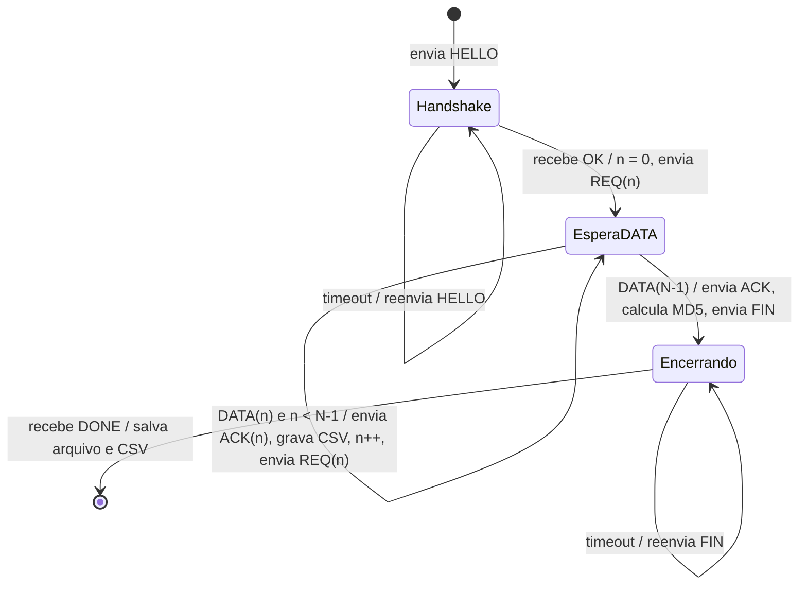

# RDT-UnB — Entrega 1: Stop-and-Wait

Cliente de transferência confiável de arquivos sobre UDP (CIC0236 — TR2, 2026/2).

## Arquivos

| Arquivo | Função |
|---|---|
| `cliente.py` | Cliente RDT-UnB com Stop-and-Wait: handshake, REQ/DATA/ACK, timeout, retransmissão, MD5, FIN/DONE, CSV |
| `graficos.py` | Lê o CSV e gera o gráfico de throughput e RTT por segmento |
| `entregas/entregaN/dados/` | CSVs, gráficos, `resumo.csv` e log das execuções de cada entrega |
| `entregas/entregaN/relatorio/` | Relatório da entrega (HTML fonte + PDF) |

Grupo 10: Anna Luiza Novaes Jansen Silva (232024572) e Vinicius Henrique Barbosa Silverio de Castro (232006832).

### Entregas (tags git) e zip para o Aprender3

Cada entrega é marcada com uma tag (`entrega1`, `entrega2`, `entrega3`, `final`). O zip é gerado a partir da tag:
```bash
git archive --format=zip --prefix=grupo10_entrega1/ -o grupo10_entrega1.zip entrega1
```

## O que precisa instalar

- **Python 3**: já está instalado.
- **matplotlib**: só para os gráficos. O Python do Homebrew não deixa instalar pacotes no
  sistema (PEP 668), então ele fica num ambiente virtual `.venv` dentro do projeto:
  ```bash
  python3 -m venv .venv
  .venv/bin/python -m pip install matplotlib
  ```
  O `cliente.py` só usa a biblioteca padrão e roda com qualquer `python3`; o `graficos.py`
  deve ser rodado com `.venv/bin/python`.
- **Wireshark**: **não é necessário na Entrega 1.** Ele só é cobrado no Relatório Final
  (seção "Análise com Wireshark"). Instale com calma antes da Semana 7.

## Como rodar

```bash
python3 cliente.py --server 137.131.178.229 --group grupo10 --file small
.venv/bin/python graficos.py metrics_grupo10_saw_AAAAMMDD_HHMMSS.csv
```

Opções: `--port` (8080), `--segment-size` (512), `--timeout` em ms (500), `--max-retries` (50).
Sem `--group` o programa termina com erro, como o enunciado exige.

Saídas: `recebido_<grupo>_<arquivo>.bin` (o arquivo baixado), `metrics_<grupo>_saw_<timestamp>.csv`,
uma linha nova em `resumo.csv` (RTT médio, throughput teórico e medido, MD5, DONE) e, depois do
`graficos.py`, um `.png` com o mesmo nome do CSV.

Testes obrigatórios (os três entram no relatório; o `resumo.csv` já vira a tabela):
```bash
python3 cliente.py --group grupo10 --file small
python3 cliente.py --group grupo10 --file medium
python3 cliente.py --group grupo10 --file large
```
Com RTT ≈ 44 ms, cada segmento leva ~1 RTT: small ≈ 2 mil segmentos (~1,5 min),
medium ≈ 10 mil (~8 min), large ≈ 20 mil (~15 min), fora os timeouts.

## Checklist da 1ª entrega parcial (15/10)

| Exigência | Onde está |
|---|---|
| `--group` obrigatório | `argparse` com `required=True` |
| HELLO/OK com negociação de `segment_size` | `request_reply` + leitura do `OK` |
| REQ → DATA → ACK com timeout e retransmissão | loop principal do `cliente.py` |
| MD5 verificado (e `DONE ok=1`) | seção 3 e 4 do `main()` |
| CSV com os campos corretos | `metrics_<grupo>_saw_<timestamp>.csv` |
| Gráfico por segmento de throughput e RTT | `graficos.py` |
| Tabela teórico × medido para small/medium/large | `resumo.csv` (após rodar os três) |
| MD5 de cada um dos três testes | ✅ seção "Resultados reais" |
| Fluxograma / máquina de estados | seção abaixo |
| Respostas (a) e (b) com os dados | ✅ seções "Análise" e "Resultados reais" |
| **Relatório PDF (máx. 5 páginas)** | a fazer, com os itens acima |

## Máquina de estados do cliente



---

## Explicação do código (`cliente.py`)

### 1. Por que UDP e o que o cliente precisa fazer

UDP só entrega datagramas "se der": pacotes podem se perder, chegar duplicados ou fora de ordem,
e não existe conexão. O TCP resolve isso com ACKs, timeouts e retransmissões. Aqui o servidor só
fala UDP, então **o cliente** implementa esses mecanismos.

O servidor é *pull-based*: ele nunca manda dados por conta própria, só responde a um `REQ`.
Por isso quem controla o ritmo, detecta perdas e retransmite é sempre o cliente.

### 2. Socket

```python
sock = socket.socket(socket.AF_INET, socket.SOCK_DGRAM)
```
`AF_INET` = IPv4, `SOCK_DGRAM` = UDP. Não há `connect()`: cada `sendto()` leva o endereço
`(IP, porta)` do servidor, e `recvfrom()` devolve um datagrama inteiro. `RECV_BUFFER = 65535` é o
maior datagrama UDP possível, então um `DATA` nunca é cortado.

### 3. Argumentos (`argparse`)

`--group` é `required=True`: se faltar, o `argparse` imprime erro e encerra antes de abrir o socket.
O valor vai no campo `grupo=` do `HELLO` e decide qual arquivo (seed) o servidor gera.

### 4. Formato dos pacotes

Tudo é texto separado por `|`, menos o payload do `DATA`, que é **binário**.

- `parse_fields` transforma `["seq=3", "total=512"]` em `{"seq": "3", "total": "512"}`.
- `parse_text_packet` trata `OK`, `DONE` e `PONG` (texto puro).
- `parse_data_packet` trata `DATA|seq=<n>|total=<b>|<payload>`. O ponto importante é
  `data.split(b"|", 3)`: divide **no máximo 3 vezes**. Como o payload é binário, ele pode conter
  o byte `|` (0x7C). Se dividíssemos em todos os `|`, o payload seria cortado e o MD5 falharia.
  Também não fazemos `decode()` do payload, porque bytes arbitrários não são texto válido.

### 5. Handshake `HELLO` / `OK` — função `request_reply`

```
HELLO|grupo=grupo10|segment_size=512|file=small
OK|file_size=...|checksum=<md5>|seed=...|total_segments=...|segment_size=...
```
O `HELLO` também pode se perder, então `request_reply` envia, espera até o timeout e, se nada
chegar, **retransmite** (até `--max-retries` vezes). Do `OK` guardamos `file_size`,
`checksum` (MD5 esperado), `total_segments` e o `segment_size` que o servidor confirmou
(é a "negociação": usamos o valor que ele devolveu, não o que pedimos).

A mesma função é reaproveitada no fim para `FIN` → `DONE`.

### 6. Loop Stop-and-Wait (o coração da entrega)

Para cada `seq` de `0` a `total_segments - 1`:

1. Envia `REQ|seq=n` e guarda `t_sent`.
2. Fica esperando com `settimeout(remaining)`, onde `remaining` é o tempo que falta até o prazo.
   - Se chegar `DATA` com o **mesmo** `seq`: aceita.
   - Se chegar `DATA` com **outro** `seq`: é uma duplicata atrasada (ex.: o servidor respondeu
     duas vezes porque retransmitimos um REQ). É descartada, e o prazo continua correndo
     (por isso usamos `remaining` e não um timeout fixo a cada `recvfrom`).
3. Se o prazo acabar sem o `DATA` certo: **timeout** → `retransmissions += 1` e volta ao passo 1
   reenviando o mesmo `REQ`. Do ponto de vista do cliente não dá para saber se perdeu o REQ
   ou o DATA; nos dois casos a solução é pedir de novo.
4. Recebeu: envia `ACK|seq=n`, junta o payload ao arquivo e passa para `n+1`.

"Stop-and-wait" = só existe **um** segmento pendente por vez (janela = 1). Só pedimos o próximo
depois de receber o atual.

**Por que o pacote nunca é aceito fora de ordem?** Como só aceitamos `seq == n`, os bytes são
sempre anexados na ordem certa; não precisa de buffer de reordenação (isso aparece no SR, Entrega 2).

### 7. Métricas por segmento (CSV)

| Coluna | Como é calculada |
|---|---|
| `segment` | `seq` |
| `timestamp` | hora local ISO 8601 com microssegundos, no momento de gravar o segmento |
| `size_bytes` | `len(payload)` (o último segmento costuma ser menor) |
| `rtt_ms` | `t_recv − t_sent`, tempo entre o **último** REQ enviado e o DATA |
| `rtt_estimated_ms` | vazio: a EWMA é da Entrega 3 (a coluna já existe para manter o formato) |
| `timeout_ms` | o timeout fixo (`--timeout`) |
| `throughput_kbps` | `size_bytes × 8 / (t_recv − t_first_req)`; inclui o tempo perdido em timeouts |
| `retransmissions` | quantas vezes o REQ deste segmento foi reenviado |
| `timeout_occurred` | 1 se houve pelo menos um timeout neste segmento |
| `window_size` | 1 |
| `protocol` | `saw` |

Nome: `metrics_<grupo>_saw_<AAAAMMDD_HHMMSS>.csv`.

**Detalhe do RTT com retransmissão (algoritmo de Karn):** se o REQ foi retransmitido, o DATA
que chegou pode ser resposta do REQ antigo, e aí o RTT seria ambíguo. Medimos a partir do
último envio, o que pode subestimar o RTT nesses casos. O TCP resolve isso ignorando amostras
de segmentos retransmitidos no cálculo do RTT estimado; vale lembrar disso na Entrega 3.

Usamos `time.monotonic()` para medir intervalos porque ele nunca "volta no tempo" (ajuste do
relógio do sistema não afeta). Para o `timestamp` do CSV usamos `datetime.now()` (relógio do
sistema), que é o mesmo que o Wireshark usa, o que facilita a correlação no relatório final.

### 8. Integridade: MD5 e `FIN` / `DONE`

Depois do último segmento, o arquivo montado é cortado em `file_size` bytes e o MD5 é
calculado com `hashlib.md5`. Comparamos com o `checksum` do `OK` e mandamos
`FIN|checksum=<md5>`. O servidor responde `DONE|ok=1` (arquivo íntegro) ou `ok=0`.
Se algo falhar, o programa sai com código 1. **O MD5 vai no relatório.**

### 9. Resumo impresso no fim

Tempo total, RTT médio/mín/máx, total de retransmissões, throughput medido
(`file_size × 8 / tempo_total`), throughput teórico (`segment_size × 8 / RTT_médio`)
e a eficiência (medido ÷ teórico).

---

## Análise pedida no enunciado

### a) Por que o throughput do SAW é limitado pelo RTT?

No Stop-and-Wait o cliente pede **um** segmento e fica parado esperando ele chegar. Em cada
RTT, só um segmento (512 bytes) atravessa a rede. Não importa se o link aguenta 100 Mbps: o
"cano" fica vazio quase todo o tempo, porque o tempo de transmissão de 512 bytes é microssegundos
e o RTT é dezenas de milissegundos. Por isso:

```
Throughput_SAW ≈ L / RTT          (L = tamanho do segmento em bits)
```

Utilização do canal (Kurose, seção 3.4): `U = (L/R) / (RTT + L/R)`. Com L = 4096 bits,
R = 100 Mbps e RTT = 44 ms: `L/R ≈ 0,04 ms`, então `U ≈ 0,04 / 44 ≈ 0,09 %`. Dobrar a banda
quase não muda nada; o que manda é o RTT. É exatamente isso que motiva as janelas
(GBN/SR) da Entrega 2: mandar vários REQs por RTT.

### b) Throughput teórico máximo vs medido

```
Throughput_máx = segment_size × 8 / RTT
```

Com o RTT do PING de teste (≈ 44 ms): `512 × 8 / 44 ms ≈ 93 kbps`.
(Exemplo do enunciado: 512 × 8 / 22 ms ≈ 186 kbps.)

O cliente já imprime os dois valores no fim usando o RTT médio real da sessão. O medido fica
**abaixo** do teórico porque:

- **Timeouts:** cada perda custa um timeout inteiro (500 ms ≈ 11 RTTs) sem nenhum dado chegando.
- **Variação do RTT:** alguns segmentos demoram bem mais que a média.
- **Overhead do cliente:** enviar o ACK, montar strings, gravar a linha do CSV, etc. É pequeno
  (microssegundos), mas existe.
- **Cabeçalho:** o que conta como "dado útil" é só o payload; o texto `DATA|seq=...|total=...|`
  e os cabeçalhos UDP/IP também ocupam a rede, mas não entram no throughput.

## Resultados reais — grupo10 (13/10/2026, segment_size = 512 B, timeout fixo = 500 ms)

| Arquivo | Segmentos | Tempo total | RTT médio | Teórico | Medido | Eficiência | Retransmissões | MD5 | DONE |
|---|---|---|---|---|---|---|---|---|---|
| small (1 MB) | 2 048 | 131,9 s | 38,49 ms | 106,41 kbps | 63,62 kbps | 59,8 % | 105 | `f989450f6ca695013ceb6bd3a5f6417c` | ok=1 |
| medium (5 MB) | 10 240 | 588,7 s | 39,17 ms | 104,56 kbps | 71,25 kbps | 68,1 % | 370 | `2593bb16a3f52e31a7b8773450e8da8b` | ok=1 |
| large (10 MB) | 20 480 | 965,9 s | 35,58 ms | 115,13 kbps | 86,84 kbps | 75,4 % | 465 | `5623bc385a7b296e6c57d99290c03c0f` | ok=1 |

Dados, CSVs e gráficos: `entregas/entrega1/dados/`. Relatório: `entregas/entrega1/relatorio/`.

### De onde vem a diferença entre teórico e medido

O tempo total se explica quase exatamente por **N × RTT + retransmissões × timeout**:

| Arquivo | N × RTT médio | Retx × 0,5 s | Soma | Tempo real | Sobra (overhead do cliente) |
|---|---|---|---|---|---|
| small | 79 s | 52 s | 131 s | 132 s | ~1 s |
| medium | 401 s | 185 s | 586 s | 589 s | ~3 s |
| large | 729 s | 232 s | 961 s | 966 s | ~5 s |

- **Os dados confirmam (a):** fora os timeouts, cada segmento custou exatamente um RTT. Tirando
  o tempo parado em timeout, o throughput fica em ~104–114 kbps, praticamente igual ao teórico
  `512 × 8 / RTT`. O link aguentaria muito mais; o limite é o RTT.
- **A perda é o que derruba o medido (b):** a taxa de perda (retx ÷ envios) foi 4,9 %, 3,5 % e 2,2 %.
  Cada perda custa 500 ms parado, cerca de 13 RTTs. No small, 40 % do tempo foi gasto esperando
  timeout; por isso a eficiência foi a menor (59,8 %). No large, com menos perda proporcional,
  chegou a 75,4 %.
- **Overhead do código é desprezível:** 1–5 s em 2–16 min (< 1 %). Ou seja, a diferença
  não é "overhead desnecessário no código" (Dica 2 do enunciado), é perda + timeout.
- **O RTT varia bastante:** mínimo ~19 ms, mediana ~26–30 ms, picos de até 243 ms. A média
  (~36–39 ms) fica acima da mediana por causa desses picos. Isso também mostra que um timeout fixo
  de 500 ms é grande demais na maior parte do tempo — motivação para o RTT adaptativo (Entrega 3).
- **Na rede real há perda natural:** os três testes tiveram retransmissões sem nenhuma
  simulação de perda; inclusive o `HELLO` do large precisou ser reenviado 3 vezes.
